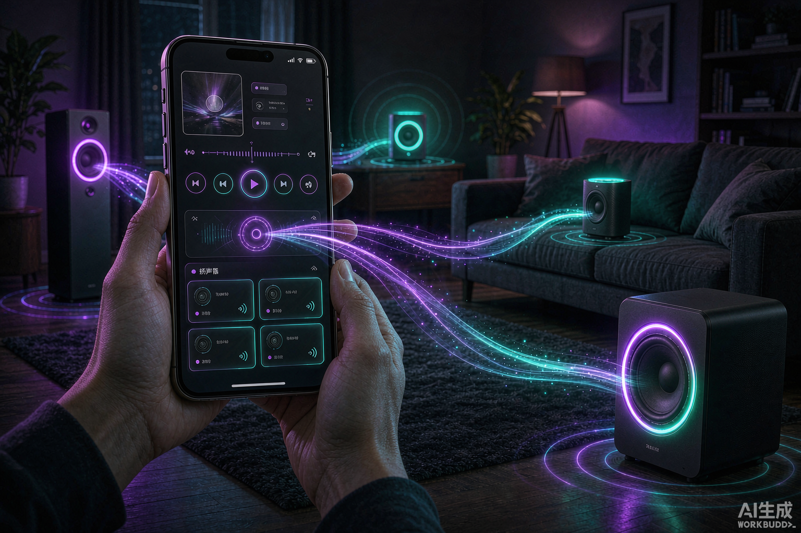
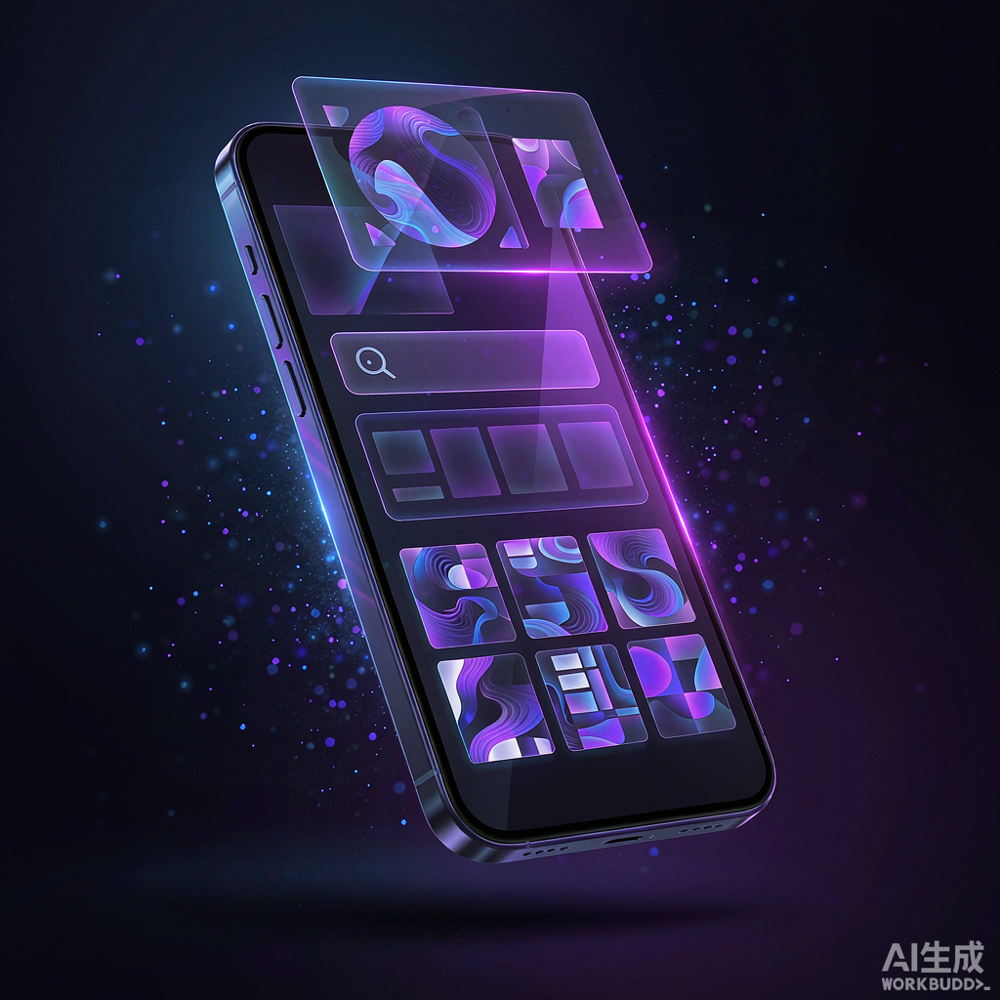
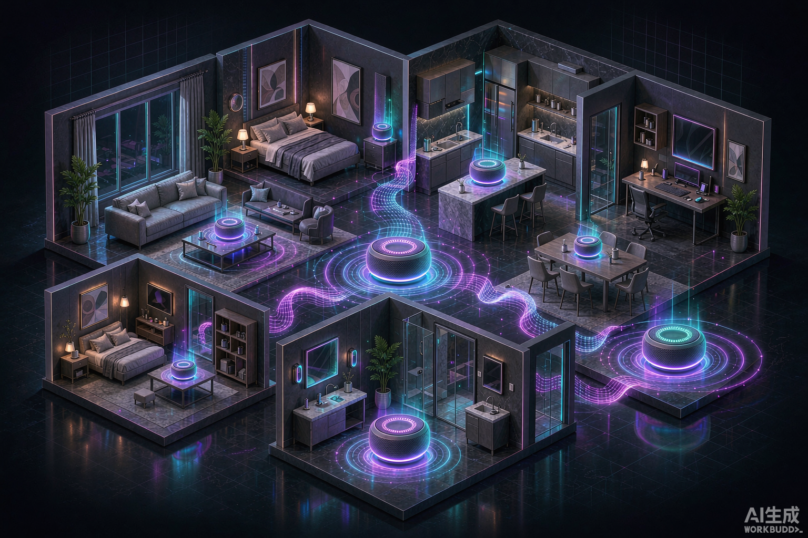
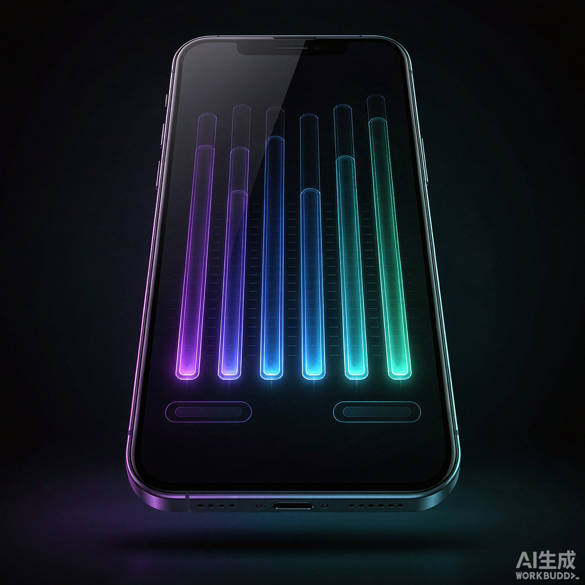

# SyncDlnaPlay 公众号推文草稿

> 用途：微信公众号文章。图片已生成在 `docs/promo-images/`，可直接插入正文。
> 语气：口语化、干货向，不夸大（第三方音源偶发不稳属音源本身问题，已在文内如实说明）。

---

## 标题候选（选一个用）

1. 家里好几台音响各放各的？一部手机让它们一起响｜开源
2. 把手机里的歌，投到全屋的 DLNA 音响：一个 3.8MB 的小工具
3. 不要会员、不要服务器，用手机把家里的旧音响盘活了
4. 投屏老失败、码率看不见？这个开源播放器把坑都填了

---

## 封面图

---

## 引言

家里的音响是不是这样：卧室一台、客厅一台、书房还有一台，全是当初便宜买的 DLNA 音箱，结果各自为政——想让全屋放同一首歌，得挨个去点；想听自己下载的无损，又得换 App；投到音响上一看，码率多少、采样率多少，全看不见。

 SyncDlnaPlay 就是为了解决这些事写的：一个不到 4MB 的安卓 App，不要账号、不要服务器，**把手机里的歌投到家里的 DLNA 音响，勾几台就几台一起响**。

---

## 它是什么

SyncDlnaPlay 是一个**赛博朋克风格**的本地优先音乐播放器 + DLNA 投放器，整个后端跑在你手机里：

- 本地曲库：手机存储、SD 卡、U 盘、局域网 SMB 共享，统统能扫进来当曲库（不用手填路径）。
- 在线搜歌/下载：接入 MusicFree 插件生态，音源可以自己加、自己停、设默认，还能记住你上次用的那一个。
- 歌词：本地 `.lrc`（UTF-8 / GBK 都认）+ 在线歌词，双击进全屏沉浸模式，投屏延迟还能手动 ±0.5s 校准。
- 边听边下载：听到喜欢的顺手就存到本地。
- **中英双语界面**，跟随系统语言，也能手动切换。

---

## 重点一：多房间同步，勾几台就一起响

DLNA 本身没有"多设备同步"协议，所以 App 的做法是：把 `Play` 指令错开下发到每台音响，再给**每一台单独做延时校准（0~5000ms，可自动测量）**，缓解不同房间不同步的问题。

发现不到任何音响时，它会**自动回落到手机本机播放**，永远不会卡在"播放失败"。

---

## 重点二：音质看得见，也能自己调

两个新加的能力，正是很多人一直想要的：

- **音频属性直接显示**：歌名后面就挂着 `(320 kbps · 44.1 kHz)` 这样的小标签，在线搜到的歌也会直接标出音源质量档位（比如 `flac` / `320k`），不用点开才知道。
- **内置 5 段均衡器（EQ）**：60 / 230 / 910 / 3k / 14k Hz，预设了 流行 / 摇滚 / 古典 / 爵士 / 人声 / 重低音 / 清脆，外加自定义（每段 −12~+12dB），设置会自动记住。

> 说明一句：EQ 作用于"手机本机"播放；投到 DLNA 音响时声音走的是音响自己的解码，手机端调音影响不到——这是 DLNA 的机制限制，不是偷懒。

---

## 解决了哪些客户的痛点

| 痛点 | 以前的样子 | SyncDlnaPlay 怎么解决 |
|---|---|---|
| **多台音响各放各的** | 想全屋同一首歌，得挨个点；贵的方案才支持多房间 | 勾选几台 DLNA 音响同时播放，逐台延时校准 |
| **曲库分散 + 会员墙** | 无损在自己硬盘、在线在下 app、会员各买各的 | 本地曲库（SD/SMB）+ 在线音源聚合到一个 App，音源自己掌控 |
| **投屏后看不见音质** | 码率、采样率一概不知，音源质量靠猜 | 歌名后直接显示码率/采样率，在线歌标质量档位 |
| **想调音没入口** | 手机播放器大多没 EQ，或要另装 | 内置 5 段 EQ + 多套预设 + 自定义，跨会话保存 |
| **投屏经常"播放失败"** | 换 Wi-Fi、音响重启就找不到设备，一脸懵 | 自动重扫局域网、按设备找回重试；找不到就回落手机播 |
| **进度条乱跳、歌词对不上** | 投屏时进度忽前忽后，歌词慢半拍 | 进度平滑过滤噪声；歌词快慢校准 + 全屏沉浸 |
| **App 臃肿 + 隐私顾虑** | 动辄上百 MB，要登录、要授权、要遥测 | 3.8MB、无账号、无服务器、MIT 开源、无遥测 |

---

## 怎么拿到

- 安卓 8.0+，下载独立版 APK 直接侧载安装即可。
- 开源仓库（含完整源码、构建脚本、桌面 E2E 测试）：`github.com/nikeat-cpu/SyncDlnaPlay`
- 另外仓库里还附带一个 **59MB 的 Docker 控制点**版本，可以常驻在 NAS / 路由器上跑（iStoreOS 实测稳定），适合不想一直开着手机的场景。

---

## 结尾引导（二选一）

- **想把自己家的旧音响盘活？** 去仓库下个 APK 试试，点个 Star 也是鼓励。
- **如果你也受够了投屏失败和看不见音质**，欢迎在评论区说说你家的音响组合，我来帮你看看能不能一起响。

---

### 配图清单（已生成，放在 `docs/promo-images/`）

- `01-cover-cast.png` — 主视觉：手机把音乐投到全屋多台音响（建议作封面 / 首图）
- `02-multiroom-sync.png` — 多房间同步概念图
- `03-eq-quality.png` — EQ 均衡器 + 音频属性特写
- `04-library-hub.png` — 本地曲库 + 在线搜索 + 歌词一体

> 公众号封面建议裁剪为 2.35:1（900×383）或 1:1；正文插图用原图即可。
